# Diagrama de funcionamiento del Certamen

Este diagrama explica el funcionamiento de nuestro intérprete de Máquinas de
Turing. La ejecución está separada en las etapas habituales de un intérprete:
análisis sintáctico, construcción de la máquina, validación semántica y
simulación.

```mermaid
flowchart TD
    A["Archivo de entrada .txt<br/><br/>Define:<br/>- Alfabeto<br/>- Estados<br/>- Estado inicial y finales<br/>- Símbolo blanco<br/>- Transiciones<br/>- Subrutinas opcionales"]

    B["Turing.g4<br/><br/>Gramática del lenguaje"]

    C["ANTLR<br/><br/>Genera automáticamente:<br/>- TuringLexer<br/>- TuringParser<br/>- TuringVisitor"]

    D["Lexer<br/><br/>Convierte el texto en tokens:<br/>MAQUINA, ESTADOS, ID, NUMERO,<br/>símbolos y movimientos"]

    E["Parser<br/><br/>Comprueba que la entrada<br/>respete la gramática y crea<br/>el árbol sintáctico"]

    F["MaquinaVisitor.ts<br/><br/>Recorre el árbol y extrae<br/>la información de la máquina"]

    G["ExpansorSubrutinas.ts<br/><br/>Copia las subrutinas utilizadas<br/>y renombra sus estados.<br/><br/>Ejemplo:<br/>e0 → llamada1__e0"]

    H["ConstructorMaquina.ts<br/><br/>Reúne estados, símbolos,<br/>transiciones, cinta y cabezal"]

    I["TablaSimbolos.ts<br/><br/>Registra estados y símbolos<br/>y evita declaraciones duplicadas"]

    J["ValidadorSemantico.ts<br/><br/>Comprueba que:<br/>- Estados y símbolos existan<br/>- El blanco pertenezca al alfabeto<br/>- La cinta sea válida<br/>- No haya transiciones ambiguas<br/>- Los movimientos sean L, R o N"]

    K["MaquinaTuring<br/><br/>Representación interna validada:<br/>estado actual, estados finales,<br/>transiciones, cinta y cabezal"]

    L["TuringEngine.ts<br/><br/>Simula paso a paso:<br/>1. Lee el símbolo<br/>2. Busca una transición<br/>3. Escribe en la cinta<br/>4. Mueve el cabezal<br/>5. Cambia de estado"]

    M["Resultado de la simulación<br/><br/>Se imprime la cinta y la traza<br/>hasta llegar a un estado final<br/>o quedar bloqueada"]

    A --> D
    B --> C
    C --> D
    C --> E
    D --> E
    E --> F
    F --> G
    F --> H
    G --> H
    H --> I
    H --> J
    I --> J
    J --> K
    K --> L
    L --> M
```

## Cómo se interpreta

1. El estudiante escribe una máquina en un archivo `.txt`, como
   `ejemplos/incrementador.txt`.
2. La gramática [`Turing.g4`](C:/dev/LP.worktrees/explicacion-archivos-no-auto-creados/Proyecto_Certamen/src/grammar/Turing.g4)
   define la sintaxis permitida.
3. ANTLR genera el lexer, el parser y el visitor a partir de esa gramática.
4. El lexer y el parser analizan el archivo y producen un árbol sintáctico.
5. [`VisitorEngine.ts`](C:/dev/LP.worktrees/explicacion-archivos-no-auto-creados/Proyecto_Certamen/src/visitor/VisitorEngine.ts)
   recorre el árbol y recoge la información declarada.
6. Si existen subrutinas, [`ExpansorSubrutinas.ts`](C:/dev/LP.worktrees/explicacion-archivos-no-auto-creados/Proyecto_Certamen/src/semantica/ExpansorSubrutinas.ts)
   las integra a la máquina renombrando sus estados para evitar conflictos.
7. [`ConstructorMaquina.ts`](C:/dev/LP.worktrees/explicacion-archivos-no-auto-creados/Proyecto_Certamen/src/semantica/ConstructorMaquina.ts)
   construye la representación interna.
8. [`ValidadorSemantico.ts`](C:/dev/LP.worktrees/explicacion-archivos-no-auto-creados/Proyecto_Certamen/src/semantica/ValidadorSemantico.ts)
   verifica que la máquina sea coherente y determinista.
9. [`TuringEngine.ts`](C:/dev/LP.worktrees/explicacion-archivos-no-auto-creados/Proyecto_Certamen/src/simulador/TuringEngine.ts)
   ejecuta la máquina sobre la cinta inicial.

La separación importante es que **ANTLR valida la estructura del texto**, pero
la lógica escrita por nosotros valida el significado del programa y ejecuta la
Máquina de Turing.

